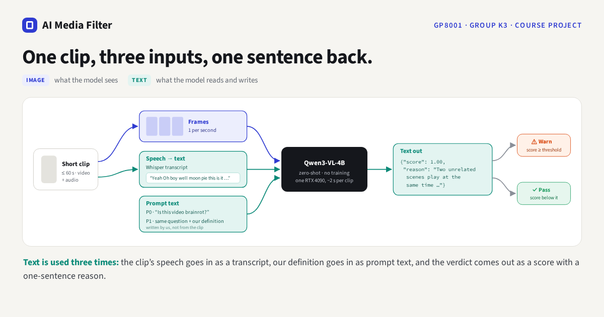

# AI Media Filter — GP8001 course assignment (Group K3)

> **Course assignment, not a research project.** Built for GP8001 (Group K3). Clips will be removed after grading.

Can an AI spot brainrot if we just tell it what brainrot is? We gave an off-the-shelf video-language model (Qwen3-VL-4B, no training) a short written definition of split-screen "sludge" and measured how its judgement changed on 267 short test videos. The model reads each clip's frames and a transcript of what is said in it, and answers with a verdict and a one-sentence reason. Adding the definition raised accuracy from 0.637 to 0.989.

**Website:** https://jang-seunghwan.github.io/course-assignment-gp8001-ai-media-filter/
The page replays results that were computed offline; nothing runs in the browser.

## Results (Table 4)

267 test clips (146 sludge, 121 not), each run once with each prompt after both prompts were frozen. A clip is flagged when its score reaches 0.5.

| Prompt | TP / FP / FN / TN | Precision | Recall | Accuracy |
|---|---|---|---|---|
| P0 · no definition | 110 / 61 / 36 / 60 | 0.643 | 0.753 | 0.637 |
| **P1 · definition** | **146 / 3 / 0 / 118** | **0.980** | **1.000** | **0.989** |

TP: sludge clip flagged · FP: normal clip flagged. For scale only: a model fine-tuned on this dataset reports 96.67% on the full 300-clip test split. Our test set leaves out the clips whose labels were flipped in the dataset's label audit, so 0.989 is optimistic for a real feed. Full numbers: [`results/metrics.md`](results/metrics.md).

## Method



P0 asks "Is this video brainrot?" with no definition; P1 adds our definition of split-screen sludge and four look-alike cases that do not count ([`prompts/`](prompts/)). The model answers yes or no; the score is the probability it gives to "yes" at that token.

## Team

<!-- team:start -->
GP8001 · Group K3 · Seunghwan Jang, Team member 2, Team member 3, Team member 4
<!-- team:end -->

## Data, model and licenses

- **Clips:** "YouTube & TikTok Sludge/Non-Sludge Dataset 2000" (Kaggle, `jobisaacong/tiktok-sludge-dataset-500`), CC BY-NC-SA 4.0. The 18 clips in `docs/assets/clips/` are 12-second excerpts from its test split, re-encoded, with `@account` watermarks blurred. They keep the dataset's CC BY-NC-SA 4.0 license and are shown for a course project only. **Clips will be removed after grading.**
- **Labels:** the dataset's corrected labels (Sludge = 1).
- **Model:** [Qwen3-VL-4B-Instruct](https://huggingface.co/Qwen/Qwen3-VL-4B-Instruct), greedy decoding, one RTX 4090. **Transcripts:** [faster-whisper](https://github.com/SYSTRAN/faster-whisper) (small).
- **Code:** no license is granted for the code in this repository (all rights reserved).

## Repository

| Path | Contents |
|---|---|
| `docs/` | The website (GitHub Pages serves this folder). `assets/site.json` holds the course and team names. |
| `src/` | Experiment code: transcription, model runs, evaluation, Gradio demo |
| `prompts/` | The two frozen prompts, P0 and P1 |
| `results/` | `P0.jsonl`, `P1.jsonl` (score and reason per test clip) and `metrics.md` |
| `design/` | The website mockup this site follows |
| `tools/` | Scripts that built the site assets from the finished experiment and check the page |

## Running `src/`

The clips, labels and transcripts are not in this repository. Put the clips in `data/clips/` and `data/labels.csv` at the repository root, then (Python 3.10+, CUDA PyTorch, `transformers>=4.57`, `qwen-vl-utils`, `faster-whisper`, `gradio`, `pandas`):

```bash
python src/01_transcribe.py      # data/clips -> transcripts/*.txt
python src/02_run_vlm.py         # test split x P0, P1 -> results/P0.jsonl, results/P1.jsonl
python src/03_evaluate.py        # -> results/metrics.md
python src/app.py                # upload demo, http://127.0.0.1:7860
```

To change team names, edit `docs/assets/site.json` and run `python tools/embed_data.py` (updates this README and the page's offline copy).
